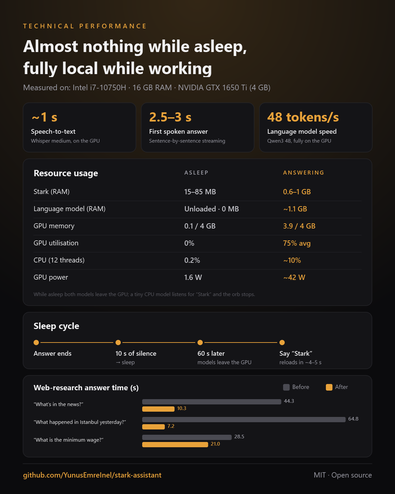

# Stark — a local, Turkish-speaking voice assistant for Windows

**Stark** is a voice assistant that runs **entirely on your own Windows PC, for free**. It speaks Turkish (and
English): say "Stark", ask your question, and it answers out loud. Speech recognition, the language model and the
voice all run locally — no subscription, no API key, no cloud account. Your conversations and memory never leave
your computer.

Internet access is optional and only used for questions that need current information (news, weather, exchange
rates, football fixtures, earthquakes).

<table>
  <tr>
    <td align="center" width="55%"></td>
    <td align="center" width="45%"></td>
  </tr>
  <tr>
    <td align="center"><b>Main panel</b> — the golden orb shows Stark's state (listening, thinking, speaking) and reacts to its voice; the conversation is also shown as text.</td>
    <td align="center"><b>Mini panel</b> — when the main window is closed, saying "Stark" brings up this small panel in the bottom-right corner without stealing focus from the app you are using.</td>
  </tr>
</table>

<sub>Window labels in these screenshots are shown in English for this README; the app's own interface is in Turkish.</sub>

> This is a personal project and is not claimed to be error-free. Because it uses a small local language model,
> some answers can be wrong — the code has several safeguards against this (see
> [How it tries to stay accurate](#how-it-tries-to-stay-accurate)).

> **Language note:** Stark talks to you in Turkish, and its interface is in Turkish. The voice commands below are
> the Turkish phrases you actually say, with their meaning in parentheses. If you speak English to it, it answers
> in English, but the built-in commands are Turkish.

---

## Contents

- [Features](#features)
- [Requirements](#requirements)
- [Installation (step by step)](#installation-step-by-step)
- [First launch and settings](#first-launch-and-settings)
- [Usage and commands](#usage-and-commands)
- [Data and privacy](#data-and-privacy)
- [Security](#security)
- [How it tries to stay accurate](#how-it-tries-to-stay-accurate)
- [Performance and memory](#performance-and-memory)
- [Troubleshooting](#troubleshooting)
- [Known limitations](#known-limitations)
- [Development](#development)
- [License](#license)

---

## Features

| Feature | Example (what you say) |
|---|---|
| **Voice conversation** | "Stark, fotosentez nedir?" (*what is photosynthesis?*) — keep talking within 10 s without saying "Stark" again |
| **Interrupting** | Say "Stark" while it is speaking; "Stark, dur" (*stop*) just silences it |
| **Current information** | "Hava nasıl?" (*how's the weather?*), "Dolar kaç lira?" (*USD to TRY?*), "Gündemde neler var?" (*what's in the news?*) |
| **Football fixtures and results** | "Galatasaray'ın yarınki maçı saat kaçta?" (*what time is Galatasaray's match tomorrow?*) — Turkish Süper Lig and major European leagues |
| **Earthquakes** | "Son deprem nerede oldu?" (*where was the last earthquake?*) — from Kandilli Observatory data |
| **Morning briefing** | "Günaydın" (*good morning*) → date, weather, today's/tomorrow's plans, notes, headlines |
| **Memory** | "Bunu hatırla: en sevdiğim renk mavi" (*remember: my favourite colour is blue*), "Neleri hatırlıyorsun?" |
| **Learns by itself** | Picks up things like "yarın sınavım var" (*I have an exam tomorrow*) from conversation (can be turned off) |
| **Teaching by voice** | "Şunu öğren: …" (*learn this: …*), "Hayır, doğrusu şu: …" (*no, the correct answer is: …*) |
| **Notes** | "Not al: Cuma kitap iade et" (*note: return the book on Friday*), "Notlarımı oku" (*read my notes*) |
| **Computer control** | "Chrome'u aç" (*open Chrome*), "YouTube'da … aç" (*play … on YouTube*), "Ekran görüntüsü al" (*take a screenshot*), "Sesi kıs" (*volume down*) |
| **Files** | "Masaüstündeki ödev dosyasını aç" (*open the homework file on my desktop*) — executables are never run |
| **Exact calculations** | "345 çarpı 27 kaç?" (*345 times 27?*), "1000 liraya yüzde 20 KDV ekle" (*add 20% VAT*), unit conversion — computed by code |
| **English–Turkish dictionary** | "According kelimesinin Türkçesi ne?" (*what is "according" in Turkish?*) — offline, Wiktionary data |
| **Screen reading** | "Ekranda ne yazıyor?" (*what's on the screen?*), "Bunu özetle" (*summarise this*), "Bunu İngilizceye çevir" (*translate this to English*) |

The full command list is in the app under the **ⓘ** button in the title bar (hover for a summary, click for the guide).

---

## Requirements

| | Minimum | Recommended |
|---|---|---|
| Operating system | Windows 10 (64-bit) | Windows 11 |
| RAM | 8 GB | 16 GB |
| Graphics card | Not required (runs on the CPU, slower) | NVIDIA with 4 GB VRAM or more |
| Disk space | ~8 GB free | |
| Microphone | Laptop microphone or headset | Headset (interrupting works more reliably) |
| Internet | Only during installation | For current-information questions |

You need these installed first (both free):

1. **Python 3.11** — [python.org/downloads/release/python-3119](https://www.python.org/downloads/release/python-3119/)
   (tick **"Add python.exe to PATH"** during setup). Python 3.12 and newer are not supported.
2. **Ollama** (runs the local language model) — [ollama.com/download](https://ollama.com/download),
   or in PowerShell: `winget install Ollama.Ollama`

---

## Installation (step by step)

### 1. Download the project

**Without Git:** click the green **Code** button at the top of this page → **Download ZIP**, then extract it, e.g.
to `Documents\stark-assistant`.

**With Git:**

```powershell
git clone https://github.com/YunusEmreInel/stark-assistant.git
cd stark-assistant
```

### 2. Run the setup script

In the project folder, type `powershell` in the File Explorer address bar and press Enter (or right-click →
"Open in Terminal"), then run:

```powershell
powershell -ExecutionPolicy Bypass -File scripts\setup_windows.ps1
```

The script does the following (no administrator rights needed, your system Python is not touched):

| Step | What it does | Size |
|---|---|---|
| Virtual environment | Installs the Python libraries into `.venv`; also installs CUDA libraries if you have an NVIDIA card | ~1–2 GB |
| Language model | `ollama pull qwen3:4b-instruct` | ~2.5 GB |
| Voice models | Speech detection, Turkish/English voices (Piper) | ~330 MB |
| Speech recognition | Whisper medium and tiny | ~1.6 GB |
| Dictionary | Builds the English–Turkish dictionary from Wiktionary (once; data is streamed, not saved) | downloads ~570 MB, keeps ~90 MB; 3–20 min |
| Launcher | Compiles `launcher\Stark.exe` and adds a **Stark** shortcut to the desktop and Start menu | |
| Tests | Runs the automated tests | |

It takes 15–60 minutes depending on your connection. If a step fails, just run the script again — finished
steps are not downloaded twice. (The script's messages are in Turkish.)

### 3. Start it

Double-click **Stark** on your desktop. It is ready when the orb turns gold (first start takes 15–30 s).

---

## First launch and settings

Open Settings with the **gear** button at the bottom of the window ("Ayarlar"):

| Setting | Description |
|---|---|
| **Adınız** (*your name*) | Optional; Stark will know your name |
| **Hitap** (*form of address*) | Default "patron" (*boss*), with the formal "siz". Change it to whatever you like |
| **Mikrofon / Hoparlör** | "Windows varsayılanı" (*Windows default*) is usually right. The input level bar should move when you speak |
| **Uyandırma testi** (*wake test*) | Say "Stark"; it shows up here when detected |
| **İnternet erişimi** (*internet access*) | **Off** by default. Turn it on for news, weather, exchange rates, fixtures and earthquakes |
| **Varsayılan şehir** (*default city*) | Used for weather and local questions |
| **Bilgi sorularını doğrula** (*verify factual questions*) | Questions with precise answers ("how many, who, when") are checked online (5–15 s) |
| **Uykudan sonra bellekten çıkar** (*unload after sleep*) | Minutes after Stark goes to sleep before the models are removed from memory and the GPU (default 1) |
| **Windows açılınca başlat** (*start with Windows*) | Launch Stark automatically |

**Optional — district names:** speech recognition sometimes misspells local district names. If you list your
city's districts in `%USERPROFILE%\.stark\yerler.json`, they are recognised correctly:

```json
{ "İzmir": ["Bornova", "Karşıyaka", "Buca", "Konak"] }
```

You can also teach them one by one: "Şunu öğren: Bornova, İzmir'in bir ilçesidir" (*learn: Bornova is a district of İzmir*).

---

## Usage and commands

1. Say **"Stark"** → it answers "Efendim patron". Then ask your question. Or in one breath: "Stark, hava nasıl?"
2. If you speak again within **10 seconds** after the answer, the conversation continues; otherwise it goes back to sleep.
3. **"Teşekkürler" / "Sağ ol" / "Bu kadar"** (*thanks / that's all*) → it goes back to sleep right away.

| Shortcut | Action |
|---|---|
| **Ctrl + Alt + W** | Wake Stark (also when it is in the background) |
| **Ctrl + Alt + S** | Stop Stark while it is speaking |
| Window **X** | Does not quit; hides Stark to the system tray |
| **Power button** / tray → "Tamamen çık" | Quits Stark completely |

If you doubt an answer, say **"internetten araştır"** (*look it up online*): your previous question is searched on
the web. To search a specific site: "Vikipedi'den bak" (*check Wikipedia*), "Maçkolik sitesine bak".

All commands with examples are in the app's **ⓘ guide**.

---

## Data and privacy

- All personal data stays **on your computer only**, in `%USERPROFILE%\.stark`:

  | File | Contents |
  |---|---|
  | `settings.json` | Your settings |
  | `stark.db` | Conversation history, memory, notes (SQLite; deleted records are wiped from the file too) |
  | `yerler.json` | (Optional) your city's districts |
  | `models\` | Voice, speech recognition and dictionary models |
  | `yedekler\` | Daily backups (last 7 days) |
  | `stark_hata.log` | Technical error log only |

- **Audio is never written to disk.** Microphone audio is processed in memory and discarded.
- **Screen-reading images are never written to disk**; text is recognised locally with Windows' built-in OCR.
- **Your conversations, memory and notes are never sent to the internet.**
- With internet access on, only current-information questions go out: search keywords (DuckDuckGo, Google/Bing
  News RSS), the city name for weather (Open-Meteo), currency codes (Frankfurter / European Central Bank), the team
  for fixtures (ESPN), and the earthquake list request (Kandilli). No personal information is added to these requests.
- Self-learning is not model training; it only extracts short notes from what you say. You can review and delete
  them in the history and memory window.
- Deleted information can remain in the daily backups for up to 7 days; Settings → **"Yedekleri sil"** (*delete
  backups*) removes them immediately.

---

## Security

- **The language model cannot run anything.** Computer commands (opening apps, searching, creating files…) are
  recognised only by fixed patterns in the code and limited to an allow-list; text generated by the model is never
  executed as a command.
- **It never deletes or overwrites files.** If a file with the same name already exists on the desktop, a new name
  is used.
- **Executables are not opened:** types such as `.exe`, `.bat`, `.ps1`, `.msi`, `.lnk`, `.iso` are only shown
  selected in their folder.
- **Content from the internet is treated as data:** web pages, news and text read from the screen are given to
  the model as "data, not instructions"; instructions inside them are ignored.
- **Numbers not found in the sources are rejected:** scores, dates, prices and times in an internet-based answer
  are checked against the sources; if they don't match, the answer is not spoken.
- The calculator does not use `eval`; it only evaluates expressions made of numbers and arithmetic operators.
- The single-instance check uses a local channel that only the same Windows user can connect to; no network port
  is opened.

If you find a security issue, please report it privately via
[GitHub security advisories](https://github.com/YunusEmreInel/stark-assistant/security/advisories/new) instead of
opening a public issue.

---

## How it tries to stay accurate

The local 4B language model is small, so its own knowledge is not trusted. Instead, Stark:

- **Handles precise tasks with code:** calculation, unit conversion, the dictionary, football fixtures (ESPN),
  earthquakes (Kandilli), weather (Open-Meteo) and exchange rates (European Central Bank) — none of these answers
  are produced by the language model.
- **Verifies factual questions online** ("how many, who, when") and shows the sources on screen.
- **Catches invented numbers:** every number in an answer is looked up in the sources.
- **Asks when it misheard:** if speech recognition is unsure, it asks you to repeat.
- **Doesn't invent personal facts:** if you ask about something not in its memory, it says it doesn't know.

---

## Performance and memory

<p align="center"></p>

Stark is meant to be used alongside other work — including games and GPU-heavy apps — so it gives the hardware
back while it waits:

- **Sleep cycle:** 10 s of silence after an answer → sleep. One minute later both the language model and the
  speech-recognition model are removed from the GPU, and Stark's memory pages are returned to Windows
  (`llama-server` disappears from Task Manager).
- **While sleeping (window in the background):** ~15–85 MB RAM, ~0.2% CPU, 60–100 MB GPU memory, 0% GPU use.
  Only a tiny CPU model listens for "Stark"; the orb animation stops while the window isn't in front.
- **When you say "Stark":** both models reload while you are speaking (~4–5 s), so the first answer after a
  long pause can be a few seconds slower; later answers are not affected.
- **Measured times** (entry-level NVIDIA card with 4 GB): speech-to-text ~1 s, first spoken words of a normal
  answer ~2.5–3 s, answers that need a web search 7–20 s, fixtures/earthquakes/calculation/dictionary ~1 s.
- Without an NVIDIA card everything runs on the CPU; choosing **small** under Settings → speech recognition
  ("Konuşma tanıma") is recommended.

---

## Troubleshooting

| Problem | Fix |
|---|---|
| **It won't start** | Check `%USERPROFILE%\.stark\stark_hata.log`; every start writes a line there |
| **"Dil modeline ulaşamadım"** (*can't reach the language model*) | Make sure Ollama is installed and running (Stark tries to start it). `ollama list` should show `qwen3:4b-instruct` |
| **It doesn't hear "Stark"** | Settings → Ses (*audio*): does the input level bar move? Try the wake test; pick the right microphone |
| **It hears itself and interrupts itself** | Use a headset or lower the speaker volume |
| **Internet questions get no answer** | Is internet access on in Settings? Free search engines may briefly return nothing after many queries |
| **Screen reading doesn't work** | The Turkish language pack must be installed: Windows Settings → Time & language → Language |
| **Python icon on the taskbar** | Unpin the old pin, then pin Stark again while it is running |
| **Setup script "cannot be loaded"** | Run it exactly as shown above, with `-ExecutionPolicy Bypass` |

---

## Known limitations

- The local 4B language model has limited general knowledge and occasionally makes Turkish grammar mistakes.
  There are safeguards against made-up answers, but correctness is not guaranteed — verify important information
  at its source.
- The wake word does not recognise who is speaking; anyone nearby can say "Stark".
- Interrupting is less reliable with speakers than with a headset.
- Free search engines may occasionally return nothing; very local events may not be in the news yet.
- Structured fixture data only covers teams in the Turkish Süper Lig and major European leagues; other teams are
  searched in the news.
- Windows only.

---

## Development

```powershell
.\.venv\Scripts\python.exe -m pytest -q          # automated tests
.\.venv\Scripts\python.exe -m stark --cli        # console version without the UI
powershell -File scripts\build_launcher.ps1      # rebuild Stark.exe and the shortcuts
.\.venv\Scripts\python.exe scripts\make_screenshots.py   # regenerate the README images
```

- Measurement and experiment scripts used during development: [scripts/dev](scripts/dev/README.md)
- Dependencies are pinned to the tested versions in `requirements.lock` (and `requirements-cuda.lock` for NVIDIA
  cards); the setup script installs exactly these.
- Architecture and the anti-hallucination layers: [docs/architecture.md](docs/architecture.md)
- When adding a new voice command, update `src/stark/ui/help_text.py` (the ⓘ guide) and this README;
  `tests/test_help.py` fails for command types missing from the guide.
- Data lives in `%USERPROFILE%\.stark` instead of AppData: processes started from Microsoft Store (MSIX) packaged
  apps have their AppData writes redirected to a package-private folder.
- Code comments are mostly in Turkish.

**Open-source components used:** PySide6 (UI), faster-whisper (speech recognition), sherpa-onnx (speech detection
and Piper voices), Ollama + Qwen3 (language model), trafilatura (web page extraction), Wiktionary (dictionary).
Details and licenses: [THIRD_PARTY_NOTICES.md](THIRD_PARTY_NOTICES.md).

---

## License

Stark's own code is released under the [MIT License](LICENSE). The downloaded models and data have their own
licenses (some Piper voices are for non-commercial use only) — see [THIRD_PARTY_NOTICES.md](THIRD_PARTY_NOTICES.md).
