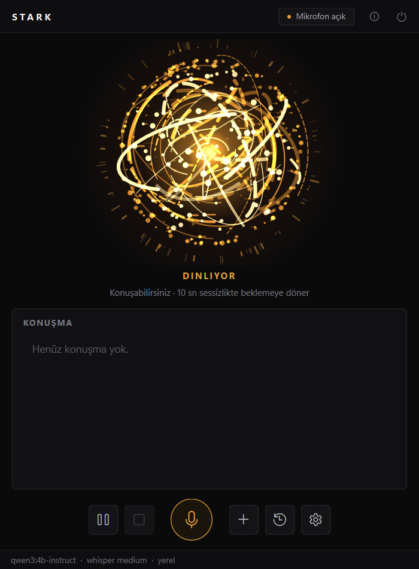
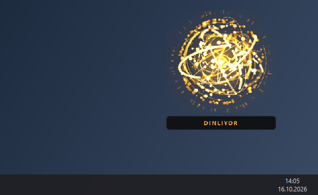

# Stark — Türkçe sesli kişisel asistan

**Stark**, Windows bilgisayarınızda **tamamen ücretsiz ve yerel** çalışan, Türkçe (ve İngilizce) konuşan bir sesli
asistandır. "Stark" diye seslenince uyanır, sorunuzu dinler, cevabı sesli söyler. Konuşmanızı yazıya çeviren model,
cevabı üreten dil modeli ve ses tamamen sizin bilgisayarınızda çalışır: abonelik, API anahtarı ya da bulut hesabı
gerekmez; konuşmalarınız ve hafızası bilgisayarınızdan çıkmaz.

İnternet isteğe bağlıdır ve yalnızca güncel bilgi gereken sorularda (haber, hava, döviz, maç, deprem) kullanılır.

<table>
  <tr>
    <td align="center" width="55%"></td>
    <td align="center" width="45%"></td>
  </tr>
  <tr>
    <td align="center"><b>Ana panel</b> — altın küre Stark'ın durumunu (dinliyor, düşünüyor, konuşuyor) ve sesini gösterir; konuşma yazılı olarak da görünür.</td>
    <td align="center"><b>Mini panel</b> — ana pencere kapalıyken "Stark" deyince ekranın sağ altında belirir; o an kullandığınız programdan odağı çalmaz.</td>
  </tr>
</table>

> Bu bir kişisel projedir; hatasız olduğu iddia edilmez. Yerel çalışan küçük bir dil modeli kullandığı için bazı
> cevaplar yanlış olabilir — kodda buna karşı korumalar vardır (bkz. [Nasıl doğru cevap vermeye çalışır?](#nasıl-doğru-cevap-vermeye-çalışır)).

---

## İçindekiler

- [Neler yapabilir?](#neler-yapabilir)
- [Gereksinimler](#gereksinimler)
- [Kurulum (adım adım)](#kurulum-adım-adım)
- [İlk açılış ve ayarlar](#i̇lk-açılış-ve-ayarlar)
- [Kullanım ve komutlar](#kullanım-ve-komutlar)
- [Veriler ve gizlilik](#veriler-ve-gizlilik)
- [Güvenlik](#güvenlik)
- [Nasıl doğru cevap vermeye çalışır?](#nasıl-doğru-cevap-vermeye-çalışır)
- [Performans ve bellek](#performans-ve-bellek)
- [Sorun giderme](#sorun-giderme)
- [Bilinen sınırlamalar](#bilinen-sınırlamalar)
- [Geliştirme](#geliştirme)
- [Lisans](#lisans)

---

## Neler yapabilir?

| Özellik | Örnek |
|---|---|
| **Sesli sohbet** | "Stark, fotosentez nedir?" — cevaptan sonra 10 sn içinde "Stark" demeden devam edebilirsiniz |
| **Söz kesme** | Stark konuşurken "Stark" deyin; "Stark, dur" yalnızca susturur |
| **Güncel bilgi** | "Hava nasıl?", "Dolar kaç lira?", "Gündemde neler var?", "Dolar neden yükseldi?" |
| **Maç programı ve sonuçları** | "Galatasaray'ın yarınki maçı saat kaçta?", "Fenerbahçe'nin son maçı kaç kaç bitti?" (Süper Lig ve büyük Avrupa ligleri) |
| **Deprem** | "Son deprem nerede oldu?", "İzmir'de deprem mi oldu?" (Kandilli Rasathanesi) |
| **Günaydın özeti** | "Günaydın" → tarih, hava, bugünkü/yarınki planlarınız, notlar, gündem |
| **Hafıza** | "Bunu hatırla: en sevdiğim renk mavi", "Neleri hatırlıyorsun?", "Unut: …" |
| **Kendi kendine öğrenme** | Sohbetten "yarın sınavım var", "daha kısa konuş" gibi bilgileri kendisi çıkarır (kapatılabilir) |
| **Sesle öğretme** | "Şunu öğren: …", "Hayır, doğrusu şu: …", "Neleri öğrendin?" |
| **Notlar** | "Not al: Cuma kitap iade et", "Notlarımı oku", "Notlarımı masaüstüne aktar" |
| **Bilgisayar kontrolü** | "Chrome'u aç", "Chrome'da Python dersleri ara", "YouTube'da Barış Manço aç", "Ekran görüntüsü al", "Sesi kıs", "Ekranı kilitle" |
| **Dosyalar** | "Masaüstündeki ödev dosyasını aç", "Son indirdiğim dosyayı aç" (program dosyaları güvenlik için çalıştırılmaz) |
| **Kesin hesaplama** | "345 çarpı 27 kaç?", "1000 liraya yüzde 20 KDV ekle", "5 mil kaç kilometre?" — sonucu kod hesaplar |
| **İngilizce-Türkçe sözlük** | "According kelimesinin Türkçesi ne?", "Serendipity ne demek?" (Vikisözlük verisi, internetsiz) |
| **Ekranı okuma** | "Ekranda ne yazıyor?", "Bunu özetle", "Bunu İngilizceye çevir", "Kopyaladığımı özetle" |
| **İngilizce** | İngilizce konuşursanız İngilizce cevap verir |

Tüm komutların listesi uygulamada başlıktaki **ⓘ** düğmesindedir (üzerine gelince özet, tıklayınca kılavuz).

---

## Gereksinimler

| | En az | Önerilen |
|---|---|---|
| İşletim sistemi | Windows 10 (64 bit) | Windows 11 |
| Bellek (RAM) | 8 GB | 16 GB |
| Ekran kartı | Gerekmez (işlemcide çalışır, daha yavaş) | NVIDIA, 4 GB veya üzeri |
| Disk | ~8 GB boş alan | |
| Mikrofon | Dizüstü mikrofonu ya da kulaklık | Kulaklık (söz kesme daha güvenilir) |
| İnternet | Yalnızca kurulumda | Güncel bilgi soruları için |

Kurulmuş olması gerekenler (ikisi de ücretsiz):

1. **Python 3.11** — [python.org/downloads/release/python-3119](https://www.python.org/downloads/release/python-3119/)
   (kurarken **"Add python.exe to PATH"** kutusunu işaretleyin). Python 3.12 ve üzeri desteklenmez.
2. **Ollama** (yerel dil modeli çalıştırıcı) — [ollama.com/download](https://ollama.com/download)
   ya da PowerShell'de: `winget install Ollama.Ollama`

---

## Kurulum (adım adım)

### 1. Projeyi indirin

**Git kullanmıyorsanız:** Bu sayfanın üstündeki yeşil **Code** düğmesi → **Download ZIP**. ZIP'i örneğin
`Belgeler\stark-asistan` klasörüne çıkarın.

**Git kullanıyorsanız:**

```powershell
git clone https://github.com/YunusEmreInel/stark-asistan.git
cd stark-asistan
```

### 2. Kurulum betiğini çalıştırın

Proje klasöründe adres çubuğuna `powershell` yazıp Enter'a basın (ya da klasörde sağ tık → "Terminalde aç"), sonra:

```powershell
powershell -ExecutionPolicy Bypass -File scripts\setup_windows.ps1
```

Betik sırasıyla şunları yapar (yönetici yetkisi gerekmez, sistemdeki Python'a dokunmaz):

| Adım | Ne yapar | Boyut |
|---|---|---|
| Sanal ortam | `.venv` klasörüne gerekli Python kütüphanelerini kurar; NVIDIA kart varsa CUDA kütüphanelerini de | ~1–2 GB |
| Dil modeli | `ollama pull qwen3:4b-instruct` | ~2,5 GB |
| Ses modelleri | Konuşma algılama, Türkçe/İngilizce sesler (Piper) | ~330 MB |
| Konuşma tanıma | Whisper medium ve tiny | ~1,6 GB |
| Sözlük | Vikisözlük'ten İngilizce-Türkçe sözlük oluşturur (bir kez) | ~90 MB, 3–20 dk |
| Başlatıcı | `launcher\Stark.exe`'yi derler, masaüstüne ve Başlat menüsüne **Stark** kısayolu koyar | |
| Testler | Otomatik testleri çalıştırır | |

Toplam süre internet hızınıza göre 15–60 dakikadır. Bir adım hata verirse betiği yeniden çalıştırmanız yeterlidir;
tamamlanan adımlar tekrar indirilmez.

### 3. Başlatın

Masaüstündeki **Stark** simgesine çift tıklayın. Küre altın rengine dönünce hazırdır (ilk açılış 15–30 sn).

---

## İlk açılış ve ayarlar

Pencerenin altındaki **dişli** düğmesiyle Ayarlar'ı açın:

| Ayar | Açıklama |
|---|---|
| **Adınız** | İsteğe bağlı; Stark adınızı bilir |
| **Hitap** | Varsayılan "patron" (resmi "siz" ile). İstediğiniz hitabı yazabilirsiniz |
| **Mikrofon / Hoparlör** | "Windows varsayılanı" çoğu zaman doğrudur. "Giriş seviyesi" çubuğu konuşunca hareket etmeli |
| **Uyandırma testi** | "Stark" deyin; algılanınca burada görünür |
| **İnternet erişimi** | Varsayılan **kapalı**. Haber, hava, döviz, maç ve deprem soruları için açın |
| **Varsayılan şehir** | Hava durumu ve yerel sorular için |
| **Bilgi sorularını doğrula** | "Kaç, kim, ne zaman" gibi kesin cevaplı sorular internetten kontrol edilir (5–15 sn) |
| **Uykudan sonra bellekten çıkar** | Stark uykuya geçtikten bu kadar dakika sonra dil modeli bellekten çıkar (varsayılan 1 dk) |
| **Windows açılınca başlat** | Stark otomatik açılır |

**İsteğe bağlı — ilçe adları:** Konuşma tanıma yerel ilçe adlarını bazen yanlış yazar. Şehrinizin ilçelerini
`%USERPROFILE%\.stark\yerler.json` dosyasına yazarsanız doğru tanınır:

```json
{ "İzmir": ["Bornova", "Karşıyaka", "Buca", "Konak"] }
```

Tek tek de öğretebilirsiniz: "Şunu öğren: Bornova, İzmir'in bir ilçesidir".

---

## Kullanım ve komutlar

1. **"Stark"** deyin → "Efendim patron". Sonra sorunuzu söyleyin. Ya da tek nefeste: "Stark, hava nasıl?"
2. Cevaptan sonra **10 saniye** içinde konuşursanız sohbet sürer; susarsanız beklemeye döner.
3. **"Teşekkürler" / "Sağ ol" / "Bu kadar"** → hemen beklemeye döner.

| Kısayol | İşlev |
|---|---|
| **Ctrl + Alt + W** | Uyandır (Stark arka plandayken de) |
| **Ctrl + Alt + S** | Konuşan Stark'ı durdur |
| Pencerenin **X**'i | Kapatmaz, saatin yanındaki tepsiye gizler |
| **Güç düğmesi** / tepsi → "Tamamen çık" | Stark'ı tamamen kapatır |

Bir cevaptan şüphelenirseniz **"internetten araştır"** deyin: önceki sorunuz internette aranır. Belirli bir
sitede aratmak için: "Vikipedi'den bak", "Maçkolik sitesine bak".

Tüm komutlar ve örnekler uygulamadaki **ⓘ Kullanım kılavuzu**ndadır.

---

## Veriler ve gizlilik

- Tüm kişisel veriler **yalnızca bilgisayarınızda**, `%USERPROFILE%\.stark` klasöründedir:

  | Dosya | İçerik |
  |---|---|
  | `settings.json` | Ayarlarınız |
  | `stark.db` | Sohbet geçmişi, hafıza, notlar (SQLite; silinen kayıtlar dosyadan da temizlenir) |
  | `yerler.json` | (İsteğe bağlı) şehrinizin ilçeleri |
  | `models\` | Ses, konuşma tanıma ve sözlük modelleri |
  | `yedekler\` | Günlük yedek (son 7 gün) |
  | `stark_hata.log` | Yalnızca teknik hata kayıtları |

- **Ses kaydı diske yazılmaz.** Mikrofon sesi bellekte işlenir ve atılır.
- **Ekran okuma görüntüsü diske yazılmaz**; yazı Windows'un kendi yazı tanımasıyla bilgisayarınızda okunur.
- **Sohbetleriniz, hafızanız ve notlarınız internete gönderilmez.**
- İnternet açıksa yalnızca güncel bilgi sorularında şunlar dışarı gider: arama anahtar kelimeleri (DuckDuckGo,
  Google/Bing Haberler RSS), hava için şehir adı (Open-Meteo), döviz için para birimi (Frankfurter / Avrupa Merkez
  Bankası), maç programı için takım (ESPN), deprem listesi isteği (Kandilli). Bu isteklere kişisel bilgi eklenmez.
- Kendi kendine öğrenme bir model eğitimi değildir; yalnızca sizin söylediklerinizden kısa notlar çıkarır.
  Geçmiş ve hafıza ekranında görüp silebilirsiniz.
- Silinen bilgiler en fazla 7 gün günlük yedeklerde kalır; Ayarlar → **"Yedekleri sil"** ile hemen silinir.

---

## Güvenlik

- **Dil modeli hiçbir şey çalıştıramaz.** Bilgisayar komutları (uygulama açma, arama, dosya oluşturma…) yalnızca
  kodda tanımlı kalıplarla tanınır ve izinli bir listeyle sınırlıdır; modelin ürettiği metin komut olarak çalıştırılmaz.
- **Dosya silmez, üzerine yazmaz.** Masaüstünde oluşturulan dosya aynı adda dosya varsa yeni bir adla oluşturulur.
- **Program dosyaları açılmaz:** `.exe`, `.bat`, `.ps1`, `.msi`, `.lnk`, `.iso` gibi türler yalnızca klasörde seçili
  gösterilir.
- **İnternetten gelen içerik veri olarak işlenir:** web sayfaları, haberler ve ekrandan okunan yazılar dil modeline
  "talimat değil, veri" olarak verilir; içlerindeki yönlendirmeler uygulanmaz.
- **Kaynakta olmayan sayılar reddedilir:** internetten gelen cevaptaki skor, tarih, fiyat ve saatler kaynaklarla
  karşılaştırılır; uyuşmazsa cevap okunmaz.
- Hesap makinesi `eval` kullanmaz; yalnızca sayı ve dört işlem içeren ifadeleri hesaplar.
- Tek kopya kontrolü yalnızca aynı Windows kullanıcısının bağlanabildiği yerel bir kanal kullanır; ağ portu açılmaz.

Bir güvenlik sorunu bulursanız lütfen herkese açık bir issue yerine GitHub'da
[özel güvenlik bildirimi](https://github.com/YunusEmreInel/stark-asistan/security/advisories/new) gönderin.

---

## Nasıl doğru cevap vermeye çalışır?

Yerel 4B dil modeli küçük olduğu için kendi bilgisine güvenilmez. Stark bu yüzden:

- **Kesin cevaplı işleri kodla yapar:** hesaplama, birim çevirme, sözlük, maç programı (ESPN), deprem (Kandilli),
  hava (Open-Meteo), döviz (Avrupa Merkez Bankası) — bu cevapları dil modeli üretmez.
- **Bilgi sorularını internetten doğrular** ("kaç, kim, ne zaman") ve kaynakları ekranda gösterir.
- **Uydurma sayıları yakalar:** cevaptaki her sayı kaynaklarda aranır.
- **Yanlış duyulanı sorar:** konuşma tanıma emin değilse "tekrar eder misiniz?" der.
- **Kişisel bilgide uydurmaz:** hafızasında olmayan bir şeyi sorarsanız bilmediğini söyler.

---

## Performans ve bellek

- **Beklerken:** Stark ~15 MB bellek kullanır; dil modeli uykuya geçtikten 1 dakika sonra bellekten çıkar
  (Görev Yöneticisi'nde `llama-server` kaybolur).
- **"Stark" deyince:** dil modeli siz konuşurken yeniden yüklenir (~3 sn).
- **Ölçülen süreler** (4 GB'lık giriş seviyesi NVIDIA kartta): konuşmayı yazıya çevirme ~1 sn, sohbet cevabının ilk
  sesi ~2,5–3 sn, internetten araştırmalı cevaplar 7–20 sn, maç/deprem/hesap/sözlük ~1 sn.
- NVIDIA kartı yoksa her şey işlemcide çalışır; Ayarlar → Konuşma tanıma → **small** seçmeniz önerilir.

---

## Sorun giderme

| Sorun | Çözüm |
|---|---|
| **Açılmıyor** | `%USERPROFILE%\.stark\stark_hata.log` dosyasına bakın; her açılış oraya bir satır yazar |
| **"Dil modeline ulaşamadım"** | Ollama'nın kurulu ve açık olduğundan emin olun (Stark kapalıysa kendisi açmayı dener). `ollama list` komutunda `qwen3:4b-instruct` görünmeli |
| **"Stark"ı duymuyor** | Ayarlar → Ses → giriş seviyesi çubuğu hareket ediyor mu? "Uyandırma testi"ni deneyin; doğru mikrofonu seçin |
| **Kendi sesini duyup kendini kesiyor** | Kulaklık kullanın ya da hoparlör sesini azaltın |
| **İnternet soruları cevapsız** | Ayarlar → İnternet erişimi açık mı? Ücretsiz arama motorları sık sorguda kısa süre sonuç vermeyebilir |
| **Ekranı okuyamıyor** | Windows Ayarlar → Saat ve dil → Dil: Türkçe dil paketinin kurulu olması gerekir |
| **Görev çubuğunda Python simgesi** | Eski sabitlemeyi kaldırıp Stark açıkken yeniden sabitleyin |
| **Kurulum betiği "çalıştırılamaz" diyor** | Komutu yukarıdaki gibi `-ExecutionPolicy Bypass` ile çalıştırın |

---

## Bilinen sınırlamalar

- Yerel 4B dil modelinin genel bilgisi sınırlıdır ve Türkçe çekimleri ara sıra kusurludur. Uydurmaya karşı
  korumalar vardır ama hatasızlık garanti edilmez; önemli bilgileri kaynağından doğrulayın.
- Uyandırma kelimesi konuşanı ayırt etmez; ortamdaki başka biri de "Stark" diyebilir.
- Hoparlörle kullanımda söz kesme, kulaklığa göre daha az güvenilirdir.
- Ücretsiz arama motorları zaman zaman sonuç vermeyebilir; çok yerel olaylar haberlere düşmemiş olabilir.
- Maç programı yalnızca Süper Lig ve büyük Avrupa liglerindeki takımlar için yapılandırılmış veriden gelir;
  diğerleri haberlerden aranır.
- Yalnızca Windows'ta çalışır.

---

## Geliştirme

```powershell
.\.venv\Scripts\python.exe -m pytest -q          # otomatik testler
.\.venv\Scripts\python.exe -m stark --cli        # arayüzsüz (konsol) sürüm
powershell -File scripts\build_launcher.ps1      # Stark.exe ve kısayolları yeniden oluştur
```

- Mimari ve uydurmaya karşı katmanlar: [docs/architecture.md](docs/architecture.md)
- Yeni bir sesli komut eklerken `src/stark/ui/help_text.py` (ⓘ kılavuzu) ve bu README güncellenmelidir;
  `tests/test_help.py` kılavuzda olmayan komut türlerinde başarısız olur.
- Veriler AppData yerine `%USERPROFILE%\.stark` altındadır: Microsoft Store paketli uygulamalardan başlatılan
  süreçlerin AppData yazıları pakete özel bir klasöre yönlendirilir.

**Kullanılan açık kaynak bileşenler:** PySide6 (arayüz), faster-whisper (konuşma tanıma), sherpa-onnx (konuşma
algılama ve Piper sesleri), Ollama + Qwen3 (dil modeli), trafilatura (web sayfası okuma), Vikisözlük (sözlük).
Ayrıntılar ve lisansları: [THIRD_PARTY_NOTICES.md](THIRD_PARTY_NOTICES.md).

---

## Lisans

Stark'ın kendi kodu [MIT lisansı](LICENSE) ile dağıtılır. İndirilen modellerin ve verilerin kendi lisansları
vardır (bazı Piper sesleri yalnızca ticari olmayan kullanım içindir) — bkz. [THIRD_PARTY_NOTICES.md](THIRD_PARTY_NOTICES.md).
